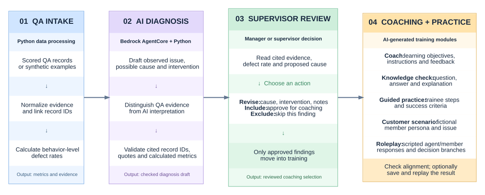

# ResultsCX × Amazon AWS AI Competition 2026

### Agent QA Review | AI assisted QA analysis, supervisor coaching, and targeted practice

I'm **George Beazer**, a senior cybersecurity student at **Kennesaw State University**. On September 17 and 18, 2026, I competed with teammates Kevin, Jackendy, Kylee, Jack, and Nelson in the ResultsCX and AWS AI College Competition.

Our team designed a working prototype around a simple problem: a QA score can tell a manager that an employee missed something, but the score alone does not explain what coaching should happen next.

We built **Agent QA Review**, an AI assisted workflow that takes scored customer service evaluations, identifies performance patterns, helps a supervisor review the evidence and likely cause, then turns the approved finding into targeted coaching and practice.

The goal was to shorten the path from **finding a QA problem** to **giving the employee a specific way to learn and practice the behavior**.

This repository presents the competition application, the product idea behind it, the code I contributed to and later refined, and a public walkthrough that can be reviewed without ResultsCX data.

## The idea in one sentence

> **Turn QA findings into manager reviewed coaching, quizzes, guided practice, realistic customer scenarios, and roleplay instead of leaving supervisors with a score and a separate manual training process.**

## The problem we wanted to improve

A traditional QA workflow can become fragmented. A supervisor may have to move between reports, evaluator comments, training material, notes, and separate coaching activities. A low score may identify **what went wrong**, but someone still has to decide what the evidence means, whether training is the right response, what should be coached, and how the employee should practice it.

Our application was designed to connect those decisions into one guided workflow:

**QA evidence → diagnosis draft → manager judgment → targeted coaching → practice**

The improvement we were trying to demonstrate was **workflow integration**. Instead of treating QA analytics, supervisor review, training design, and practice as separate activities, the same finding can move through the entire process while a human supervisor stays in control.

This is not a claim that the prototype outperforms a named commercial QA platform. It is the product idea we were pitching: make the path from a QA finding to useful coaching faster, more focused, and easier to trace back to the original evidence.

## What the application is meant to do

### For supervisors and managers

The application is designed to help a supervisor:

1. See behavior level defect rates and the evaluator comments behind them.
2. Review AI proposed findings instead of starting from a blank page.
3. Separate **observed QA evidence** from the AI's **inferred explanation**.
4. Check which source records support a finding.
5. Edit the proposed root cause and recommended intervention.
6. Add supervisor notes and include or exclude findings.
7. Decide which issues actually need training.
8. Open targeted coaching and practice material for the approved issue.
9. Reopen saved results when a saved run exists.

The intention is to reduce the manual work between identifying a problem and preparing a focused coaching session without removing the manager from the decision.

### For employees and trainees

For an approved finding, the coaching workflow is designed to provide:

1. A clear learning objective.
2. Short targeted instruction.
3. A knowledge check with answer choices, a suggested answer, and feedback.
4. A guided exercise with trainee and facilitator instructions.
5. Observable success criteria.
6. A realistic fictional customer or healthcare member scenario.
7. A benchmark for what good performance should look like.
8. A branching roleplay where the simulated customer reacts differently depending on whether the target behavior is demonstrated.
9. Coach notes showing what to pay attention to during practice.

The purpose is not simply to tell an employee that a QA item was missed. It is to give the employee something specific to **learn, practice, and discuss with a supervisor**.

### For customers and healthcare members

The application is not a customer facing chatbot. The customer benefit is indirect: the concept is intended to help employees practice the behaviors that affect service quality, including clear explanations, documentation, verification, and handling realistic member situations.

Because some competition scenarios involved healthcare member services, the training workflow supports fictional scenarios involving benefits, claims, EOBs, care plans, provider outreach, and HIPAA verification.

## Why this approach could be useful

Compared with a fragmented manual workflow, the application is intended to offer:

* **More focused coaching:** training is built around a specific scored behavior instead of generic customer service material.
* **Faster preparation:** AI gives the manager a structured starting point instead of requiring every coaching activity to be created from scratch.
* **Human control:** supervisors can edit, reject, or exclude findings before training is generated.
* **Traceability:** findings can be tied back to specific QA record IDs and evaluator comments.
* **Consistent practice:** quizzes, exercises, scenarios, and roleplay can follow the same learning objective.
* **Clearer fact versus inference:** the interface separates what evaluators actually observed from what the model believes may explain it.
* **Reusable review:** saved runs can be reopened instead of forcing every review to begin again.

These are intended product advantages. I do **not** claim measured labor savings, defect reduction, or production performance because the repository does not contain post deployment business results.

## How the application works

I used Streamlit to connect four parts of the process. The dashboard lets supervisors move from QA findings to a specific coaching decision, while the AI handles the diagnosis draft and the training content for selected findings.

[](https://raw.githubusercontent.com/BeazerJobs-USA/ResultsCX-Amazon-AWS-AI-Competition-2026/main/docs/architecture-flow.svg)

**[Open the full-size architecture diagram](https://raw.githubusercontent.com/BeazerJobs-USA/ResultsCX-Amazon-AWS-AI-Competition-2026/main/docs/architecture-flow.svg)**. The SVG stays sharp when zoomed in.

| Stage | What happens |
| --- | --- |
| **1. QA intake** | I load scored evaluations, keep the evidence tied to record IDs, and calculate behavior-level defect rates in Python. The public walkthrough uses invented records. |
| **2. AI diagnosis** | Bedrock proposes the observed problem, a possible root cause, confidence, and an intervention. Python checks the citations against the loaded records instead of accepting them at face value. |
| **3. Supervisor review** | A supervisor or manager can read the evidence, adjust the root cause and intervention, add notes, and include or exclude findings. Escalation can be recommended, but the app does not dispatch operational tasks. |
| **4. Coaching and practice** | Selected findings become targeted instruction, a knowledge check with answer and feedback, a guided exercise with scoring criteria, a fictional customer scenario, and an agent/member roleplay script with branches. The app checks structural alignment and can save results for replay. |

The knowledge check displays questions and suggested answers; it does not grade a trainee's responses. The roleplay is a **generated practice script**, not a live customer conversation or an autonomous customer-facing agent. The AI workflow uses one AgentCore harness session with separate prompts for diagnosis and training.

`get_data.py` prepares records and calculates defect rates. `prompts.py` defines the diagnosis and coaching instructions. `harness_client.py` is the AWS boundary and parses the streamed AgentCore response. `pipeline.py` verifies citations, attaches Python-calculated metrics, manages reviewed findings, and checks whether generated modules contain expected elements. `app.py` brings the stages together in Streamlit. `main.py` provides terminal checks.

This is a **multi-stage AI workflow**, with a human review step. I do not describe it as six independently deployed agents because the code does not establish that.

## Product experience and feature vision

These images show the broader coaching experience we wanted the application to communicate. They use **synthetic information** and are illustrative interface mockups rather than screenshots captured from the current `app.py` build. The sample savings shown are not measured outcomes.

| Coaching and roleplay concept | Coaching focus and alignment concept |
| --- | --- |
| [](docs/screenshots/agent-qa-roleplay-demo.webp) | [](docs/screenshots/agent-qa-coaching-focus-demo.webp) |
| Fictional branching dialogue, quiz and guided practice | Synthetic QA baseline, learning objective and alignment example |

The working Streamlit interface uses a four stage layout. I kept the mockups because they show the intended product experience: a manager moves from a QA issue into coaching, a knowledge check, guided practice, and realistic roleplay while keeping the training tied to the original problem. Their exact limitations are explained in [Screenshot notes](docs/SCREENSHOTS.md).

## Healthcare privacy and security design

Because the use case can involve healthcare member service data, confidentiality is part of the application design rather than an afterthought.

| Control | Plain English purpose |
| --- | --- |
| **Synthetic data by default** | The public walkthrough runs without real customer, member, or employee records. |
| **Employee pseudonyms** | The private data path replaces known employee identities with codes before model use. |
| **Identifier masking** | The parser masks several common patterns such as emails, phone numbers, dates, provider references, and long identifiers. |
| **Private data read gate** | Private QA files are not read unless an explicit configuration switch is enabled. |
| **Cloud send gate** | The private data path is blocked from being sent to AWS unless a separate explicit authorization switch is enabled. |
| **Private output storage gate** | Derived private JSON is not written locally unless a separate storage switch is enabled. |
| **Credential separation** | AWS identifiers and credentials stay outside the source code and use environment configuration and Boto3's credential provider chain. |
| **Repository exclusions** | `.gitignore` keeps company workbooks, credentials, local environment files, real name lists, logs, and saved outputs out of Git. |
| **Evidence validation** | The pipeline checks record ID, behavior, and quoted text before labeling a diagnosis citation verified. |

These controls reflect **HIPAA aware confidentiality concerns and privacy minded development**, especially the goal of minimizing unnecessary exposure of healthcare related information.

They do **not** make the prototype HIPAA compliant. The masking is not certified de identification, saved JSON is not encrypted, and this repository cannot verify organizational AWS agreements, IAM policy, retention controls, or authorization to process protected health information.

See [Security](docs/SECURITY.md) for the implementation boundaries.

## My technical contributions

My contribution focused on helping turn the team's idea into a working technical workflow. I assisted with coding, troubleshooting, AWS integration, data handling, the Streamlit graphical interface, prompt workflow, and security minded handling of sensitive data. These are the specific areas I worked on:

1. **Development setup:** I configured our local GitHub project in VS Code on Windows 11 and worked through Python virtual environment and path problems using `uv`.
2. **Dependencies:** I resolved installation and import issues involving Boto3, OpenPyXL, pandas and requests during development. The public dependency list now contains only the packages the application uses.
3. **AWS SDK bug:** I fixed the type passed as `runtimeSessionId`. Boto3 expects a string; `str(uuid.uuid4())` produces the 36-character value used by our harness client.
4. **Streamlit UI:** I built and debugged parts of `app.py`, including moving QA findings into a supervisor review and coaching workflow.
5. **Data processing:** I investigated retrieval and parsing issues in `get_data.py` and helped connect the extracted evidence to the analysis stages.
6. **Prompt design:** I wrote and revised instructions separating observed evidence from inferred causes, structured JSON responses, supervisor review, and targeted training content.

I also worked on the privacy and security side of the application because the healthcare member service use case can involve sensitive information. The current public code keeps credentials outside source code, uses pseudonyms in the private data path, masks several common identifier patterns, and requires explicit controls before private QA data can be read, sent to AWS, or saved as derived output. These are **HIPAA aware confidentiality controls**, not a claim of HIPAA compliance. The masking is not certified de identification and saved JSON is not encrypted.

I worked with the team; I did not write every part of the application by myself. The September competition prototype and this later, public-safe cleanup are separate pieces of work.

## What you can run

| Mode | What it does | Needs AWS or private data? |
| --- | --- | --- |
| **Synthetic walkthrough** (default) | Runs the dashboard with nine invented QA line items and handwritten diagnosis/training examples | No |
| **Live Bedrock** | Uses `boto3` and AgentCore `InvokeHarness` to generate an analysis and coaching modules | Yes, an authorized harness and credentials |
| **Saved-run replay** | Reopens JSON results saved by an earlier run | No live AWS call, but a saved run must already exist |

The synthetic walkthrough is deliberately **not** presented as AI output, an actual ResultsCX evaluation, or measured business performance.

## Run it locally

I developed on Windows 11. I verified this public build with Python 3.12 and a locked dependency set. From PowerShell with Git and [`uv`](https://docs.astral.sh/uv/) installed:

```powershell
git clone https://github.com/BeazerJobs-USA/ResultsCX-Amazon-AWS-AI-Competition-2026.git
cd ResultsCX-Amazon-AWS-AI-Competition-2026

uv venv --python 3.12
.\.venv\Scripts\Activate.ps1
uv pip install -r requirements.lock

python -m unittest discover -s tests -v
python -m streamlit run app.py
```

Select **Synthetic walkthrough**, click **Load synthetic walkthrough**, review the sample findings, and use the review form to open the matching practice modules. No AWS credentials are needed.

For a terminal-only check, `python main.py --dry-run` builds the synthetic-data prompt without calling AWS. The `--live` flag is required for terminal model invocation, and the UI has a separate Live mode. I explain the environment variables and approval requirements in [Setup](docs/SETUP.md).

## AWS integration and security

The actual application uses the **Bedrock AgentCore `InvokeHarness` API**, not the separate `InvokeAgentRuntime` request shape. In `harness_client.py`, Boto3 sends the harness ARN, a string runtime session ID, and messages, then parses streamed content and tool-use events.

```python
session_id = str(uuid.uuid4())
response = client.invoke_harness(
    harnessArn=approved_harness_arn,
    runtimeSessionId=session_id,
    messages=[{"role": "user", "content": [{"text": sanitized_prompt}]}],
)
```

This excerpt shows the API shape, not a complete standalone script. The code gets `HARNESS_ARN` from local configuration and credentials from Boto3's AWS provider chain. My `.env.example` contains placeholders; no real keys are included.

I kept the original private QA exports, real-name masking list, access-key files, saved run outputs and unused generated workbook parser out of the public repository. The default is synthetic data. Private-data reading, cloud transmission and local output storage have separate opt-in controls; those switches are **not substitutes for authorization or a privacy review**.

I also tightened the citation check. A citation is marked verified only when its ID exists, it belongs to the diagnosed behavior, and its quoted text matches that record. Alignment checking is still a structural and keyword heuristic, not proof that training is effective. See [Security](docs/SECURITY.md) and [Architecture](docs/ARCHITECTURE.md).

## Verification and limits

I run the offline tests with:

```powershell
python -m unittest discover -s tests -v
```

**26 offline tests pass** in a fresh Python 3.12 environment using `requirements.lock`. They cover synthetic record calculations, stream parsing, the Boto3 request shape, supervisor-to-training flow, actual Streamlit script progression, replay behavior, citation checks, and private-data access guards. They do **not** invoke AWS or use confidential ResultsCX workbooks. The live harness connection requires separate authorized testing.

The dashboard examples use invented cases. No post-training QA comparison has been supplied, so I don't claim an actual reduction in defects or real labor savings. This is a student competition project, not a deployed ResultsCX system.

## Competition rubric

| Criterion | Weight |
| --- | ---: |
| Diagnostic Accuracy | 25% |
| End-to-End Generation | 25% |
| Training Alignment | 20% |
| Practice Scripting | 10% |
| Feasibility | 10% |
| Presentation | 10% |

Those are the competition's rubric weights, **not our awarded scores**. I have not published a placement.

## Repository map

```text
app.py                     Streamlit dashboard
main.py                    Terminal check and live runner
get_data.py                Synthetic/private data loading and deterministic metrics
prompts.py                 Diagnosis and coaching instructions
harness_client.py          Boto3 InvokeHarness integration and stream parsing
pipeline.py                Citations, supervisor handoff, generation and alignment
sample_walkthrough.py      Handwritten offline demonstration (not model output)
sample_data/               Invented public QA records
tests/                     Offline unit and app-flow tests
.streamlit/config.toml     Dashboard theme
docs/                      Architecture, security, setup, screenshots, contributions
requirements.txt           Supported dependency ranges
requirements.lock          Tested Python 3.12 versions
```

## Team and next steps

My teammates were **Kevin Jackendy, Kylee, Jack Nelson**. We worked on the same competition project, and I have kept the contributions I can personally account for separate from the team's overall work.

The next steps are to capture the current Streamlit workflow, finish authorized testing against the live AWS harness, and compare the coaching output with actual follow-up QA results if those become available.

*ResultsCX and AWS are trademarks of their owners. This is an independent student-team project, not an official ResultsCX or AWS product.*
