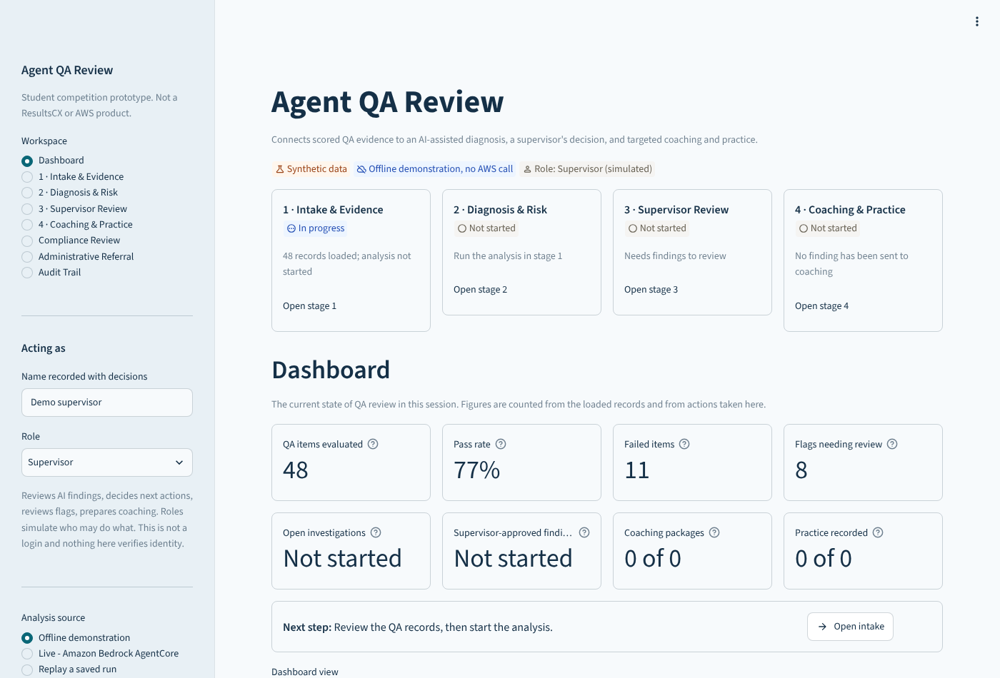
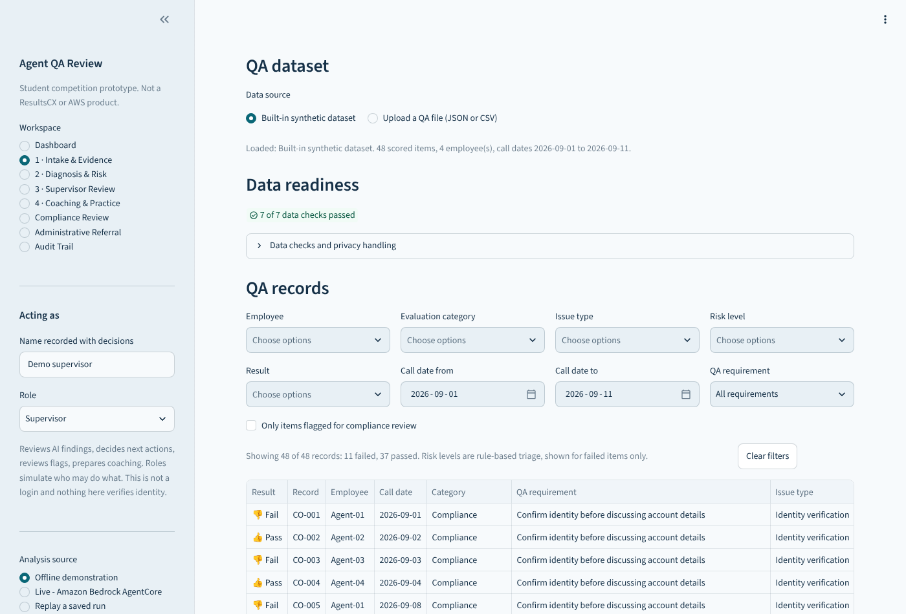
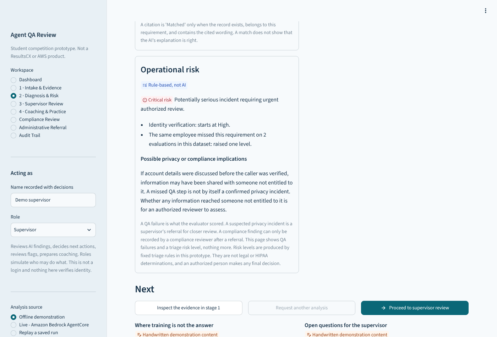
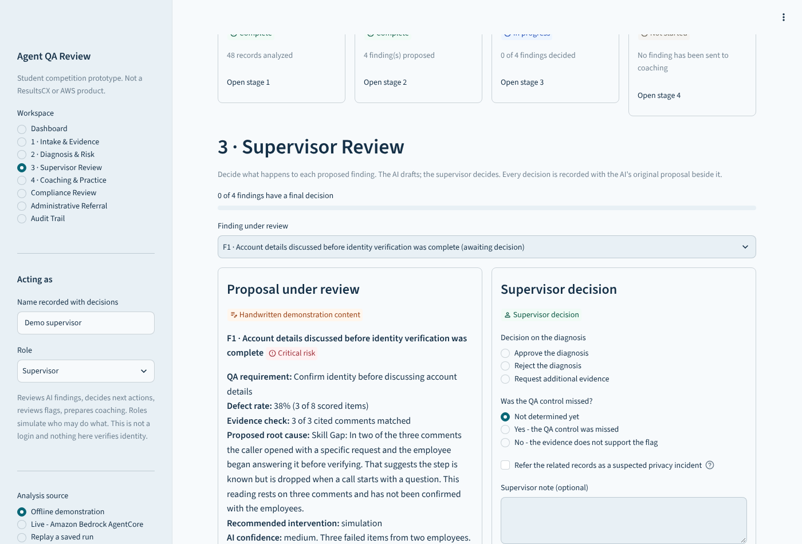
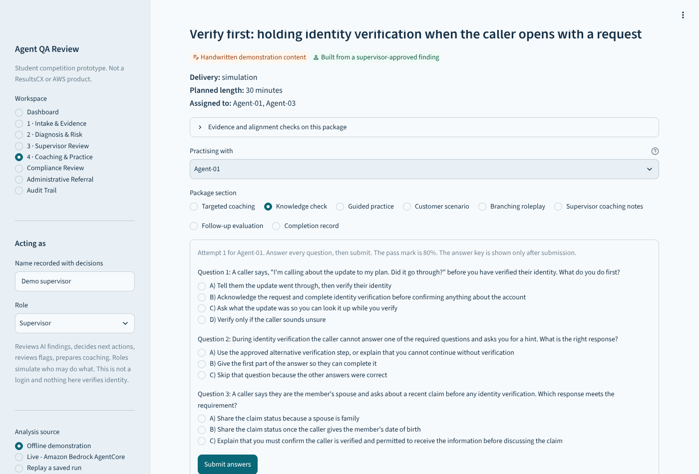
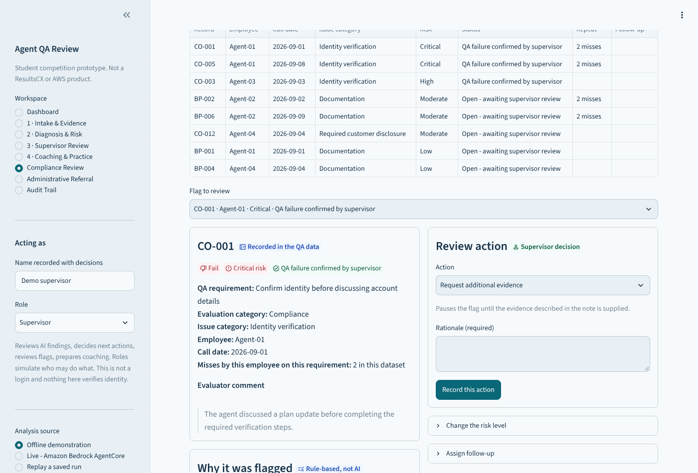
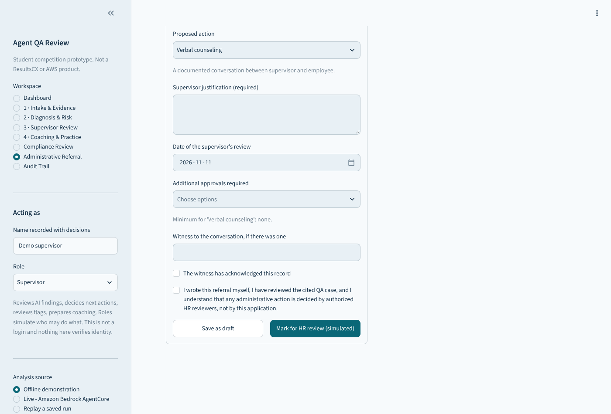

# ResultsCX × Amazon AWS AI Competition 2026

### Agent QA Review | From a failed QA item to a supervisor's decision and targeted coaching

A failed QA item is only the start of the work. Someone has to look at the evidence, decide whether the control was really missed, decide what the employee needs, and prepare practice that fits the problem. **Agent QA Review** walks one QA problem through that path in four stages and keeps a person in charge of every decision:

**QA evidence → AI diagnosis → supervisor validation → targeted coaching → follow-up**



[](docs/architecture-flow.svg)

I'm **George Beazer**, a senior cybersecurity student at **Kennesaw State University**. On September 17 and 18, 2026, I competed with teammates Kevin, Jackendy, Kylee, Jack, and Nelson in the ResultsCX and AWS AI College Competition. This repository holds that application, rebuilt in November 2026, and my notes on what it does and doesn't prove.

## The four stages

| Stage | What happens |
| --- | --- |
| **1 · Intake & Evidence** | Load the built-in synthetic data or upload a CSV/JSON file. The file is validated, names become codes, and identifiers are masked. Filter by employee, category, risk, date, issue type and result. Read the evaluator comment next to the QA requirement it failed. A readiness check must pass before any analysis starts. |
| **2 · Diagnosis & Risk** | The recorded QA facts are shown apart from the AI proposal: possible root cause, risk, corrective actions and stated uncertainty. Python recomputes every figure and checks each cited comment against the record. The supervisor can inspect the evidence, ask for another analysis, or proceed. |
| **3 · Supervisor Review** | Approve, reject, edit, or request more evidence. Confirm the QA control was missed, or dismiss the flag. Refer a suspected privacy issue. A note is required to reject, overturn, or materially change a finding. The AI's original text stays beside the final decision. |
| **4 · Coaching & Practice** | For approved findings only. The supervisor picks the components first, then the package is built: targeted coaching, a **graded** knowledge check, guided practice, a customer scenario, a **branching** roleplay, coaching notes, a remediation plan and a follow-up evaluation. Completion is tracked per employee. |

Three supporting workspaces sit beside the stages: **Compliance Review** (flags with rule-based Low, Moderate, High and Critical levels), **Administrative Referral** (a clearly labeled simulation) and **Audit Trail** (a hash-chained log of every action).

### Rules the application follows

- **The AI proposes; the supervisor decides.** Nothing reaches coaching without a recorded human decision.
- **Nothing is invented.** The app has no call audio. It never makes up transcripts, timestamps, quotes or policy citations. When a dataset has no evidence for a field, it says so.
- **Pass, fail and pending are shown with an icon and a word,** never color alone: green thumbs-up for pass, red thumbs-down for fail, neutral for pending or insufficient evidence.
- **A missed verification step is a QA finding, not a confirmed HIPAA violation.** Risk levels come from simple rules and are not legal determinations.
- **The HR referral is a simulation.** A supervisor writes it, it stays in memory, no HR system is contacted, and the AI never recommends or imposes discipline.
- **The roleplay is a decision tree, not a live conversation.** A choice leads to a different member reaction and coach feedback. A written script with no choices is labeled as a script.

## What it looks like

| | |
| --- | --- |
|  |  |
| **1 · Intake & Evidence** | **2 · Diagnosis & Risk** |
|  |  |
| **3 · Supervisor Review** | **4 · Coaching & Practice** |
|  |  |
| **Compliance Review** | **Administrative Referral (simulation)** |

These are captures of the running app in headless Chrome using the offline demonstration source and synthetic data. See [Screenshots](docs/SCREENSHOTS.md).

## Three ways to run it

| Mode | What it does | Needs AWS? |
| --- | --- | --- |
| **Offline demonstration** (default) | Uses 48 invented QA records and **handwritten** findings and coaching content. It is labeled as such everywhere and is not AI output. | No |
| **Live: Amazon Bedrock AgentCore** | Calls one AgentCore harness through `InvokeHarness`. Masked data is sent. If AWS is missing or fails, the app explains the problem and loads nothing. | Yes |
| **Replay a saved run** | Reopens a diagnosis and coaching packages saved by an earlier live run, read-only. | No |

## Run it

```bash
git clone https://github.com/BeazerJobs-USA/ResultsCX-Amazon-AWS-AI-Competition-2026.git
cd ResultsCX-Amazon-AWS-AI-Competition-2026
python -m venv .venv && source .venv/bin/activate      # Windows: .\.venv\Scripts\Activate.ps1
pip install -r requirements.lock

python -m unittest discover -s tests -v
streamlit run app.py
```

No AWS credentials are needed for the offline demonstration. Setup for live mode, including the harness variables, is in [Setup](docs/SETUP.md). `python main.py --dry-run` builds the prompt without calling AWS.

## Verification

**109 tests pass** on Python 3.13 with the locked dependency set (`requirements.lock`, Streamlit 1.67). On Python 3.12, which CI uses, 106 pass and the 3 browser tests skip because Playwright isn't installed there. None of them call AWS.

| Layer | Tests | What they cover |
| --- | --- | --- |
| Workflow logic | 50 | Intake and filters, upload validation, risk rules, flag actions and roles, review validation, decision records, audit chain tampering, referrals, quiz grading, roleplay branching, labor math |
| Real Streamlit (`AppTest`) | 15 | Every workspace, the review flow, graded quiz, roleplay choices, compliance and referral actions, live mode without configuration |
| Real browser (headless Chrome) | 3 | Every workspace, a review decision through to a quiz, rejection of a bad upload |
| Earlier suites | 41 | Stream parsing, request shape, masking, citations, private-data guards, replay |

**Not verified:** a live AWS call, the team's deployed harness, behavior on a real user's browser or phone, and any real ResultsCX data. Details and gaps are in [Verification](docs/VERIFICATION.md).

## Privacy and security

Synthetic data is the default. Names are replaced with codes, common identifiers are masked before anything reaches a model, uploaded files and local exports are treated as private, and private data needs separate switches before it is read, sent to AWS, or saved. Credentials stay out of the code.

These are confidentiality controls, **not a claim of HIPAA compliance**. The masking uses regular expressions and misses things. Roles are simulated and nothing verifies identity. The audit chain detects edits to the log but isn't tamper-proof. Do not enter real protected health information. See [Security](docs/SECURITY.md).

## Business case

The dashboard has an efficiency estimate with every input editable and every formula shown. With the example inputs (40 packages a week, 30 minutes by hand against 18 with AI help including review, 50 weeks, $45 an hour) it comes to 8 hours a week, 400 a year, about $18,000 in labor capacity. Those are assumptions. Nothing was measured, the estimate can go negative, and it says nothing about whether coaching improves QA scores.

## My contributions

I worked with a team and didn't write all of this myself. For the competition build I assisted with coding, troubleshooting, AWS integration, data handling, the Streamlit interface, the prompt workflow, and security-minded handling of sensitive data. The November 2026 rebuild was done with AI coding assistance. [Contributions](docs/CONTRIBUTIONS.md) separates the competition work from the later changes.

## Repository map

```text
app.py                   Entry point: sets up state, draws the sidebar, opens a workspace
ui/                      One module per workspace, plus shared components and actions
workflow/                Logic with no Streamlit: intake, review, compliance, coaching,
                         referrals, analytics, audit chain, store operations
get_data.py              Dataset building from synthetic data, uploads or local exports
security_controls.py     Masking before any model call; Markdown escaping
business_impact.py       Efficiency estimate with validation and visible formulas
prompts.py               Diagnosis and coaching prompts
harness_client.py        InvokeHarness client and stream parsing
pipeline.py              Citation checks, storage and cloud-send rules, generation
sample_walkthrough.py    Handwritten offline demonstration content
sample_data/             Invented QA records and demonstration content
tests/                   Logic, AppTest and browser tests
docs/                    Architecture, security, setup, verification, screenshots
```

*ResultsCX and AWS are trademarks of their owners. This is an independent student-team project, not an official ResultsCX or AWS product.*
