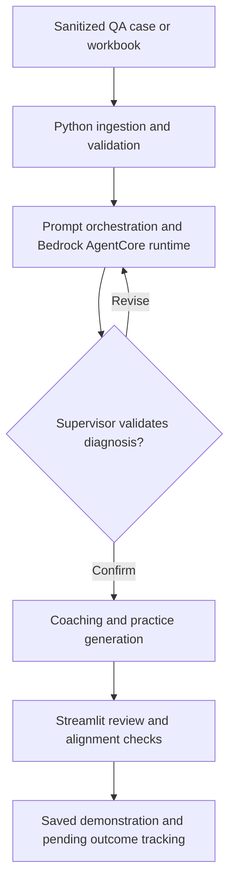

# ResultsCX × Amazon AWS AI Competition 2026

### Agent QA Review | Evidence-informed diagnostics and targeted coaching

**Student hackathon prototype · September 17–18, 2026 · Python · Streamlit · Amazon Bedrock AgentCore**

An application concept and working competition demonstration for turning quality-assurance (QA) findings about customer-service interactions into actionable coaching material. The team combined Python data processing, a Streamlit interface, and an AWS-backed generative-AI workflow with a **supervisor review checkpoint** between diagnosis and training generation.

> **Portfolio scope:** This is a student competition project, not a ResultsCX or Amazon production system. The images below are **user-provided demonstration visuals containing synthetic cases and simulated metrics**. They document the proposed interface and workflow; they do not independently prove a live AWS invocation, measured business improvement, regulatory compliance, or the date of the competition demo. The original application source is **not yet included in this public repository** pending permission and confidential-data review. Reference code is labeled separately.


*Illustrative demonstration — Case F2, documentation accuracy. Shows a supervisor-confirmed coaching plan, fictional roleplay, knowledge check, guided practice, and simulated labor-cost scenario. Post-training outcomes remain pending.*

**[View the second interface example: coaching focus and alignment check](docs/screenshots/agent-qa-coaching-focus-demo.webp)** · **[Screenshot provenance and limitations](docs/SCREENSHOTS.md)**

## Project Overview

The challenge: QA reports can identify agent mistakes, but translating evidence into specific, repeatable practice takes time. Our team's approach was to organize that work into a reviewable sequence:

1. Read a QA case or sanitized spreadsheet record.
2. Generate a diagnosis grounded in the supplied evidence, distinguishing observed facts from inference.
3. Ask a human supervisor to validate or revise the finding.
4. Generate a coaching focus, conversation guide, knowledge check, guided practice, scenario, and roleplay script.
5. Check that the generated practice aligns with the confirmed diagnosis and record follow-up outcome status.

**Prototype capabilities shown in the supplied visuals:** selectable demo/recovery mode, case selection, supervisor confirmation indicators, coaching sections, knowledge-check questions, branching practice content, alignment check, and explicitly simulated cost examples.

The project was built for the **ResultsCX and AWS AI College Competition, September 17–18, 2026**. Our team reported positive feedback from judges on technical execution; no placement, award, or quantified post-training improvement is claimed here.

### Competition evaluation rubric

| Evaluation area | Weight | How the prototype addressed the requirement |
| --- | ---: | --- |
| Diagnostic Accuracy | 25% | Evidence-oriented QA issue identification and human validation |
| End-to-End Generation | 25% | Connected flow from case intake to coaching outputs |
| Training Alignment | 20% | Checks that exercises relate to a confirmed finding |
| Practice Scripting | 10% | Guided scenarios and agent/member roleplay |
| Feasibility | 10% | Python and Streamlit workflow with saved-run demonstration mode |
| Presentation | 10% | Clear, step-by-step dashboard and narrative |

These are **rubric weights**, not the project's awarded scores.

## System Architecture

The design uses a **staged, multi-agent-style supervisor pipeline**. “Multi-agent-style” refers to separated reasoning and generation responsibilities; without the original deployable source and AWS deployment evidence in this repository, it should **not** be interpreted as proof of multiple independently deployed agents.



| Layer | Project files described by the team | Responsibility |
| --- | --- | --- |
| User interface | `app.py` | Streamlit case navigation, coaching content, user interaction |
| Entry point and orchestration | `main.py`, `pipeline.py` | Session setup and coordination of processing stages |
| QA data ingestion | `get_data.py` | Read, normalize, and validate spreadsheet-derived evidence |
| Model instruction templates | `prompts.py` | Structured analysis, supervisor handoff, coaching and practice instructions |
| AWS integration | `harness_client.py` | Boundary for invoking an AgentCore runtime using Boto3 |
| Deterministic calculations | `labor_cost.py` | Explicitly labeled assumptions and illustrative cost calculations |

**These are descriptive filenames from the competition workflow, not a claim that those source files are present in this initial public release.** See [Architecture and evidence boundaries](docs/ARCHITECTURE.md).

## Technical Contribution Highlight — George Beazer

**George Beazer — Technical architecture and integration lead (student team role).** A senior cybersecurity student at **Kennesaw State University**, George contributed hands-on engineering while working full time as a UPS heavy-truck mechanic. His work connected development environment reliability, Python runtime integration, API debugging, UI construction, and prompt workflow design.

| Engineering area | Specific work | Skill demonstrated |
| --- | --- | --- |
| Developer environment | Configured the GitHub project in VS Code on Windows 11; resolved local paths and Python environment problems using `uv`/virtual environments | Version control, Windows troubleshooting, reproducibility |
| Dependency management | Diagnosed installation and import issues involving `openpyxl`, `boto3`, `pandas`, and `requests` | Package management, Python debugging, environment isolation |
| AWS SDK integration | Corrected an incorrect UUID value type by passing `str(uuid.uuid4())` as Boto3's `runtimeSessionId` in `main.py` | API contracts, type correctness, AWS integration |
| Streamlit UI | Constructed and debugged the interface in `app.py`, including case-to-coaching presentation | UI engineering, state and data-flow troubleshooting |
| Data processing | Debugged QA data retrieval and processing paths in `get_data.py` | Input validation, data pipelines, root-cause analysis |
| AI workflow design | Developed prompt instructions for evidence-based diagnosis, staged specialist tasks, supervisor confirmation, and coaching generation | Prompt engineering, human-in-the-loop controls |
| Secure handling approach | Worked on environment-based configuration and safeguards for healthcare-adjacent QA content | Secrets hygiene, privacy-aware design, trust boundaries |

These contributions are **participant-reported** and can be supported with original source history, selected code excerpts, issue notes, and a recorded demo when release permission is established. The description does **not** imply George solely authored the entire team application.

## AWS Bedrock API Integration

The project used Python/Boto3 to interact with an AWS-managed generative-AI runtime. An AgentCore-style invocation uses an `agentRuntimeArn`, a **string** session ID, and a JSON payload. To avoid embedding identifiers or credentials in code, the public reference implementation reads a runtime ARN from `HARNESS_ARN` (or `AGENT_RUNTIME_ARN`) and relies on Boto3's credential-provider chain.

```python
from uuid import uuid4

session_id = str(uuid4())  # Boto3 expects a string, not a UUID object
```

See the independently written [AgentCore reference example](examples/bedrock_agentcore_reference.py). It demonstrates the API shape; it is **not** presented as the team's original competition implementation.

**Secret handling:** `HARNESS_ARN` is a runtime resource identifier and should be kept in local or deployment configuration; AWS access keys and tokens are credentials and **must not be committed**. Use an AWS profile, IAM Identity Center, or short-lived role credentials where possible. The `.env.example` file intentionally contains no live values.

AWS reference: [AgentCore runtime invocation](https://docs.aws.amazon.com/bedrock-agentcore/latest/devguide/runtime-invoke-agent.html) · [Boto3 credential-provider chain](https://docs.aws.amazon.com/boto3/latest/guide/credentials.html).

## Security Practices

This project is especially relevant to entry-level cybersecurity and IT engineering because it requires careful handling of application boundaries, cloud permissions, and potentially sensitive support records.

- **Configuration isolation:** use process environment variables and the AWS SDK credential chain; never hardcode keys, tokens, or actual runtime ARNs in public examples.
- **Data minimization:** use only synthetic/redacted QA cases in the public repository; exclude ResultsCX competition materials and any customer/member identifiers.
- **Human approval:** treat generated diagnoses and training content as drafts until a supervisor validates them; do not confuse an on-screen “confirmed” demo badge with externally audited approval.
- **Untrusted model output:** validate structured fields, keep factual evidence distinct from model inference, and avoid interpreting generative output as authoritative policy.
- **Least privilege:** restrict runtime invocation and data access to required IAM actions; prefer short-lived sessions over static access keys.
- **Safe logging:** avoid logging raw prompts, credentials, member identifiers, or sensitive customer interaction details.

**Important distinction:** These are documented design principles and recommended release safeguards, **not a security audit**. This repository currently does not prove encryption at rest, HIPAA compliance, IAM policy enforcement, penetration testing, or production security certification. See [Security practices and release checklist](docs/SECURITY.md).

## Installation

**Release status:** The initial public repository contains documentation, demo visuals, and isolated reference examples. It **does not yet include the original `app.py`, `main.py`, or private QA input files**, so the complete competition application cannot be run from this release alone.

When an approved, sanitized version of the original application source is added, the intended Windows 11 local setup is:

```powershell
# Install uv separately first: https://docs.astral.sh/uv/
uv venv
.\.venv\Scripts\Activate.ps1
uv pip install streamlit boto3 openpyxl pandas requests

# Configure an authorized AWS profile separately (or use an IAM role).
$env:AWS_PROFILE = "your-approved-profile"
$env:AWS_DEFAULT_REGION = "us-east-1"  # Replace with actual runtime region
$env:HARNESS_ARN = "arn:aws:bedrock-agentcore:REGION:ACCOUNT:runtime/APPROVED-RUNTIME"

# After approved application source has been added:
streamlit run app.py
```

The precise dependencies, entry point, ARN variable name, IAM permissions, and region must be reconciled with the released source. The values above are **setup examples**, not verified configuration for the original competition environment. See [Windows setup notes](docs/SETUP.md).

## Usage

The designed user journey is:

1. Open the Streamlit dashboard and choose **saved demonstration** or **new AI analysis** when runtime access is authorized.
2. Select the number of cases and review supporting, sanitized QA evidence.
3. Inspect the diagnosis and **confirm or revise it as a supervisor** before proceeding.
4. Review the coaching plan, knowledge check, guided practice, practice scenario, and roleplay script.
5. Inspect the alignment indicators. Treat baseline rates and labor scenarios as **synthetic/illustrative**; the screenshots explicitly mark the post-training comparison **PENDING**.

### Interface gallery

| Roleplay and practice | Coaching focus and alignment |
| --- | --- |
| [](docs/screenshots/agent-qa-roleplay-demo.webp) | [](docs/screenshots/agent-qa-coaching-focus-demo.webp) |
| Fictional dialogue, branch guidance, knowledge check, supervised practice | Synthetic HIPAA-verification example, learning objective, alignment review |

## Repository Layout

```text
ResultsCX-Amazon-AWS-AI-Competition-2026/
├── README.md
├── .env.example
├── .gitignore
├── docs/
│   ├── ARCHITECTURE.md
│   ├── CONTRIBUTIONS.md
│   ├── SCREENSHOTS.md
│   ├── SECURITY.md
│   ├── SETUP.md
│   └── screenshots/
│       ├── agent-qa-coaching-focus-demo.webp
│       └── agent-qa-roleplay-demo.webp
├── examples/
    ├── README.md
    ├── bedrock_agentcore_reference.py
    └── qa_data_validation_reference.py
└── tests/
    └── test_qa_data_validation_reference.py
```

**Future, approval-dependent additions:** sanitized `app.py`, `main.py`, `get_data.py`, `pipeline.py`, `prompts.py`, `harness_client.py`, `labor_cost.py`, dependency lockfile, synthetic fixtures, and focused tests. These are **planned files**, not files falsely represented as already committed.

## Team and Contributions

- **George Beazer:** technical architecture/integration lead; Windows/Python setup, dependency fixes, AWS session type correction, UI, data debugging, and prompt design.
- **Kevin, Jackendy, Kylee, Jack, and Nelson:** competition teammates and collaborators. Individual technical assignments are not attributed without their confirmation.

This was a **team project** completed for an academic competition, not employment with ResultsCX or AWS. For a more detailed, interview-defensible breakdown see [Contribution notes and commit guidelines](docs/CONTRIBUTIONS.md).

## Engineering Lessons and Next Evidence

- Cloud API contracts matter: a `uuid.UUID` object and its string form are not interchangeable for a parameter expecting `str`.
- Virtual environment and working-directory issues can block an entire demo despite correct application logic.
- Separating evidence, model interpretation, supervisor decision, and training generation makes output easier to review.
- Saved-run recovery improves demo resilience but must not be confused with proof of a live model request.
- Business-impact estimates require transparent assumptions; measured before/after outcomes are a **separate future evaluation**.

**Evidence to add once cleared:** authorized source with meaningful commit history, a sanitized end-to-end demo recording, unit tests for ingestion and session-ID handling, screenshots from a verified running build, and a brief security control-to-code mapping.

## Attribution and Confidentiality

ResultsCX, Amazon Web Services (AWS), and related product names belong to their respective owners. This is an independent student-team portfolio project. No private ResultsCX datasets, employee or customer records, Amazon credentials, or confidential competition materials should be uploaded. The team retains its own contributions; other teammates' work must be credited appropriately.

