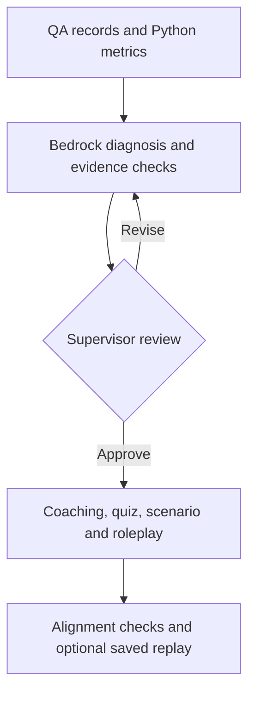

# ResultsCX × Amazon AWS AI Competition 2026

### Agent QA Review | Python, Streamlit, and Amazon Bedrock AgentCore

I'm **George Beazer**, a senior cybersecurity student at **Kennesaw State University**. On September 17 and 18, 2026, I competed with Kevin, Jackendy, Kylee, Jack, and Nelson in the ResultsCX and AWS AI College Competition.

Our team built a QA diagnosis and coaching prototype. The idea was straightforward: read scored customer-service evaluations, identify where an agent is struggling, let a supervisor review the finding, then generate training and practice material for the specific issue. We presented a working team demonstration to the judges and received positive feedback on our technical execution.

I worked on the Python environment, AWS integration troubleshooting, Streamlit interface, data retrieval, and prompt workflow. This repository includes the application code I shared, my updated tests, and a safe public demonstration that does not require access to ResultsCX files.

## What you can run

| Mode | What it does | Needs AWS or private data? |
| --- | --- | --- |
| **Synthetic walkthrough** (default) | Runs the dashboard with nine invented QA line items and handwritten diagnosis/training examples | No |
| **Live Bedrock** | Uses `boto3` and AgentCore `InvokeHarness` to generate an analysis and coaching modules | Yes, an authorized harness and credentials |
| **Saved-run replay** | Reopens JSON results saved by an earlier run | No live AWS call, but a saved run must already exist |

The synthetic walkthrough is deliberately **not** presented as AI output, an actual ResultsCX evaluation, or measured business performance.

## The application

I used Streamlit to connect the workflow into four stages:



`get_data.py` prepares records and calculates defect rates. `prompts.py` defines the diagnosis and coaching instructions. `harness_client.py` is the AWS boundary and parses the streamed AgentCore response. `pipeline.py` verifies citations, attaches Python-calculated metrics, manages reviewed findings, and checks whether generated modules contain expected elements. `app.py` brings the stages together in Streamlit. `main.py` provides terminal checks.

This is a **multi-stage AI workflow**, with a human review step. I do not describe it as six independently deployed agents because the code does not establish that.

## Screens and interface design

These two images were prepared as **illustrative interface mockups using synthetic information**. They are not screenshots captured from the current `app.py` build, and the sample savings shown are not measured outcomes.

| Coaching and roleplay concept | Coaching focus and alignment concept |
| --- | --- |
| [](docs/screenshots/agent-qa-roleplay-demo.webp) | [](docs/screenshots/agent-qa-coaching-focus-demo.webp) |
| Fictional branching dialogue, quiz and guided practice | Synthetic QA baseline, learning objective and alignment example |

The working Streamlit interface uses a four-stage layout. I kept the mockups as design references, with their limitations explained in [Screenshot notes](docs/SCREENSHOTS.md).

## My technical contributions

I was the technical architecture and integration lead for my part of the team. These are the specific problems I worked on:

1. **Development setup:** I configured our local GitHub project in VS Code on Windows 11 and worked through Python virtual environment and path problems using `uv`.
2. **Dependencies:** I resolved installation and import issues involving Boto3, OpenPyXL, pandas and requests during development. The public dependency list now contains only the packages the application uses.
3. **AWS SDK bug:** I fixed the type passed as `runtimeSessionId`. Boto3 expects a string; `str(uuid.uuid4())` produces the 36-character value used by our harness client.
4. **Streamlit UI:** I built and debugged parts of `app.py`, including moving QA findings into a supervisor review and coaching workflow.
5. **Data processing:** I investigated retrieval and parsing issues in `get_data.py` and helped connect the extracted evidence to the analysis stages.
6. **Prompt design:** I wrote and revised instructions separating observed evidence from inferred causes, structured JSON responses, supervisor review, and targeted training content.

I was also responsible for privacy-aware handling in my part of the application. The current code uses environment configuration, pseudonyms for the private-data path, and a gate before private QA data can be sent to AWS. I am **not** claiming the regex masking is complete de-identification, that saved JSON is encrypted, or that the prototype is HIPAA compliant.

I worked with the team; I did not write every part of the application by myself. The September competition prototype and this later, public-safe cleanup are separate pieces of work.

## Run it locally

I developed on Windows 11. I verified this public build with Python 3.12 and a locked dependency set. From PowerShell with Git and [`uv`](https://docs.astral.sh/uv/) installed:

```powershell
git clone https://github.com/BeazerJobs-USA/ResultsCX-Amazon-AWS-AI-Competition-2026.git
cd ResultsCX-Amazon-AWS-AI-Competition-2026

uv venv --python 3.12
.\.venv\Scripts\Activate.ps1
uv pip install -r requirements.lock

python -m unittest discover -s tests -v
python -m streamlit run app.py
```

Select **Synthetic walkthrough**, click **Load synthetic walkthrough**, review the sample findings, and use the review form to open the matching practice modules. No AWS credentials are needed.

For a terminal-only check, `python main.py --dry-run` builds the synthetic-data prompt without calling AWS. The `--live` flag is required for terminal model invocation, and the UI has a separate Live mode. I explain the environment variables and approval requirements in [Setup](docs/SETUP.md).

## AWS integration and security

The actual application uses the **Bedrock AgentCore `InvokeHarness` API**, not the separate `InvokeAgentRuntime` request shape. In `harness_client.py`, Boto3 sends the harness ARN, a string runtime session ID, and messages, then parses streamed content and tool-use events.

```python
session_id = str(uuid.uuid4())
response = client.invoke_harness(
    harnessArn=approved_harness_arn,
    runtimeSessionId=session_id,
    messages=[{"role": "user", "content": [{"text": sanitized_prompt}]}],
)
```

This excerpt shows the API shape, not a complete standalone script. The code gets `HARNESS_ARN` from local configuration and credentials from Boto3's AWS provider chain. My `.env.example` contains placeholders; no real keys are included.

I kept the original private QA exports, real-name masking list, access-key files, saved run outputs and unused generated workbook parser out of the public repository. The default is synthetic data. Private-data reading, cloud transmission and local output storage have separate opt-in controls; those switches are **not substitutes for authorization or a privacy review**.

I also tightened the citation check. A citation is marked verified only when its ID exists, it belongs to the diagnosed behavior, and its quoted text matches that record. Alignment checking is still a structural and keyword heuristic, not proof that training is effective. See [Security](docs/SECURITY.md) and [Architecture](docs/ARCHITECTURE.md).

## Verification and limits

I run the offline tests with:

```powershell
python -m unittest discover -s tests -v
```

**26 offline tests pass** in a fresh Python 3.12 environment using `requirements.lock`. They cover synthetic record calculations, stream parsing, the Boto3 request shape, supervisor-to-training flow, actual Streamlit script progression, replay behavior, citation checks, and private-data access guards. They do **not** invoke AWS or use confidential ResultsCX workbooks. The live harness connection requires separate authorized testing.

The dashboard examples use invented cases. No post-training QA comparison has been supplied, so I don't claim an actual reduction in defects or real labor savings. This is a student competition project, not a deployed ResultsCX system.

## Competition rubric

| Criterion | Weight |
| --- | ---: |
| Diagnostic Accuracy | 25% |
| End-to-End Generation | 25% |
| Training Alignment | 20% |
| Practice Scripting | 10% |
| Feasibility | 10% |
| Presentation | 10% |

Those are the competition's rubric weights, **not our awarded scores**. I have not published a placement or an unverified award.

## Repository map

```text
app.py                     Streamlit dashboard
main.py                    Terminal check and live runner
get_data.py                Synthetic/private data loading and deterministic metrics
prompts.py                 Diagnosis and coaching instructions
harness_client.py          Boto3 InvokeHarness integration and stream parsing
pipeline.py                Citations, supervisor handoff, generation and alignment
sample_walkthrough.py      Handwritten offline demonstration (not model output)
sample_data/               Invented public QA records
tests/                     Offline unit and app-flow tests
.streamlit/config.toml     Dashboard theme
docs/                      Architecture, security, setup, screenshots, contributions
requirements.txt           Supported dependency ranges
requirements.lock          Tested Python 3.12 versions
```

## Team and next steps

My teammates were **Kevin, Jackendy, Kylee, Jack and Nelson**. I credit them as collaborators without guessing their individual code ownership. For the next revision, I want a genuine screen recording of the sanitized app and authorized test evidence for the live AWS workflow.

The current source and public walkthrough let a hiring manager inspect the code and reproduce the offline flow. If an interviewer asks what I personally fixed or why a control exists, I can explain the change and point to the relevant module.

*ResultsCX and AWS are trademarks of their owners. This is an independent student-team competition portfolio, not an official product or employment project.*
