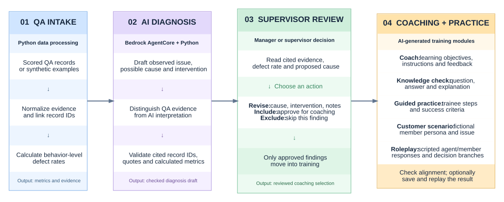

# Architecture notes

I kept the logic, the screens and the AWS boundary in separate layers so each can be tested alone, and so the QA numbers, the model's interpretation, the supervisor's judgment and the training output are never mixed up as one kind of evidence.

The editable [Graphviz source](architecture-flow.dot) sits beside the [SVG](architecture-flow.svg).

## Layers

| Layer | Modules | Rule |
| --- | --- | --- |
| Entry point | `app.py` | Sets page config, initializes state, draws the sidebar and header, opens one workspace. 36 lines. |
| Screens | `ui/` | One module per workspace (`dashboard`, `intake`, `diagnosis`, `review`, `coaching`, `compliance`, `referral`, `audit`) plus `shell`, `state`, `actions`, `components`. The only code that imports Streamlit, apart from `app.py`. |
| Workflow logic | `workflow/` | Plain Python with no Streamlit import: `intake`, `review`, `compliance`, `coaching`, `referrals`, `analytics`, `audit`, `operations`, `common`. Raises `WorkflowError` and leaves the store untouched on failure. |
| Data and rules | `get_data.py`, `security_controls.py`, `business_impact.py` | Dataset building, masking and escaping, estimate math. |
| AI boundary | `prompts.py`, `harness_client.py`, `pipeline.py` | Prompts, the `InvokeHarness` client, and everything that checks what comes back. |
| Offline content | `sample_walkthrough.py`, `sample_data/` | Invented records and handwritten findings. |

## Session state

All decisions, drafts and selections live in plain dictionaries in `st.session_state` (`store`, `drafts`, `ui`, `practice`), never only in a widget. Streamlit discards a widget's value when the widget isn't drawn on a run, so a value typed before a change of workspace would be lost otherwise. Input helpers in `ui/components.py` write each value to its dictionary from both the widget's return value and an `on_change` callback.

The **case store** (`workflow/operations.py`) holds `flags`, `decisions`, `packages`, `trackers`, `referrals` and `audit`. Every change goes through an operation that validates first, works on copies, and commits only if every step succeeds.

Streamlit won't let a widget's key change after the widget exists, so a navigation request made mid-run is stored as `pending_nav` and applied at the top of the next run.

## Data flow

1. **Intake.** `get_data.dataset_from_records` builds one dataset shape from the synthetic fixture, an upload, or a local export. `workflow.intake.data_checks` must pass before analysis can start.
2. **Diagnosis.** Offline, `sample_walkthrough.demo_diagnosis` supplies handwritten findings. Live, `pipeline.run_diagnosis` sends the masked payload through one harness session. Either way `pipeline.validate_diagnosis` checks citations and recomputes metrics.
3. **Review.** `workflow.review.validate` checks a decision. `operations.record_decision` keeps the AI's original text (`ai_original`) beside the final text, updates related flags, and appends to the audit chain.
4. **Coaching.** The supervisor's component choice goes into `prompts.build_training_prompt`. `pipeline.merge_training` replaces only the modules that were regenerated, so a failed regeneration never discards an earlier package.

## Risk rules

`workflow/compliance.py` classifies each failed requirement into an issue category, starts at that category's base level, raises it one level for a repeat miss by the same employee, and one more for a comment that mentions a person other than the verified member. The reasons are stored with the level. A reviewer can override the level with a required note, and the rule-based level is kept.

## One harness, not several agents

The live code uses **one AgentCore harness session** with separate prompts for diagnosis and each coaching package. It is not a network of independently deployed agents, and I don't describe it as one. `harness_client.py` handles the streamed events, limits tool-use rounds, reports interrupted streams, and turns AWS failures into messages that say what to fix. `server_tool_use` and `mcp_tool_use` blocks are handled by the harness; only client tool requests are answered locally.

## What I can't verify from this repository

- Live AWS credentials, permissions and the deployed harness. Tests use fake streams.
- The September demonstration's runtime state.
- Training effectiveness. No post-training QA data exists.
- Behavior in a browser other than headless Chrome.
