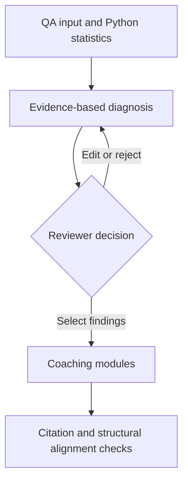

# Architecture notes

I kept the processing stages separate because the QA numbers, model interpretation, supervisor judgment, and training output should not be treated as the same kind of evidence.

## What the code does

| Module | My reading of its responsibility |
| --- | --- |
| `get_data.py` | Loads nine invented QA records by default. With explicit authorization switches, it can read local Excel exports and apply limited masking. It computes the rates in Python. |
| `prompts.py` | Renders the metrics/evidence into a JSON-constrained diagnosis prompt and a separate prompt for each selected coaching module. |
| `harness_client.py` | Builds `InvokeHarness` requests, handles streamed text/tool events, and gives common failures actionable messages. It reuses one string session ID for related requests. |
| `pipeline.py` | Validates JSON, matches record IDs/behaviors/quotes, applies supervisor edits, requests training, performs structural alignment checks, and optionally saves results. |
| `app.py` | Presents QA data, diagnosis, review and coaching in Streamlit. Supports live, saved-run and synthetic walkthrough modes. |
| `sample_walkthrough.py` | Provides handwritten fictional findings and modules for an AWS-free public demonstration. |
| `main.py` | Supports offline checks and an explicitly requested live terminal run. |

The live code uses **one AgentCore harness session** and sequential prompts for diagnosis and approved findings. There is no demonstrated network of independently deployed specialist agents. The supervisor step happens in the Streamlit UI; CLI `--full` uses a clearly labeled test-only automatic selection and should not be counted as human approval.

## Verification details

I changed citation validation because the original implementation treated an existing record ID as verified even when it belonged to a different QA behavior. It also did not verify that the model's quoted words actually appeared in the record.

Now the diagnosis check requires all three:

1. The record ID exists.
2. The record is for the same scored behavior and section.
3. The quoted phrase appears in the stored evaluator comment after whitespace/case normalization.

For training-module references, the validator checks that a cited ID exists and belongs to the right behavior. The separate alignment function uses simple keyword overlap and checks for an objective, scenario, roleplay, and scoring criteria. **That is a heuristic**, not a semantic assessment or measured learning outcome.

## What I cannot verify from this release

- Live AWS credentials, permissions, and the deployed harness. The tests validate the Boto3 request against the SDK service model with a fake client; they do not contact AWS.
- The original September demonstration's runtime state or deployment configuration. The supplied ZIP is one code snapshot, not a complete historical commit trail.
- Production privacy controls. The private-data scrubber uses regexes and known names, which can miss identifiers. The public walkthrough avoids this by using invented records.
- Training effectiveness. The screenshots show pending or simulated values, and no measured post-training data is available.

These boundaries help me explain what was actually built without promising more than the code shows.

