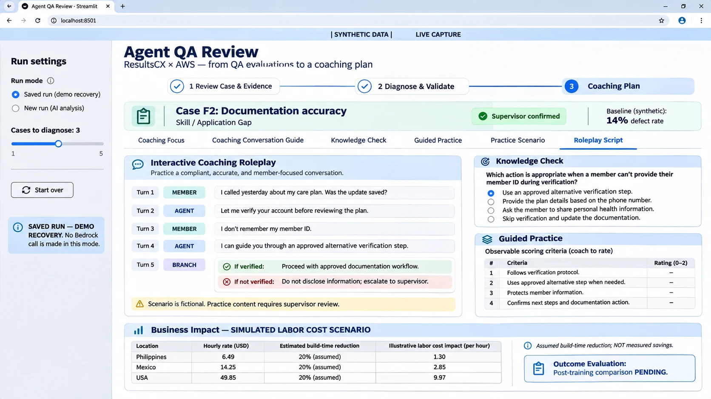
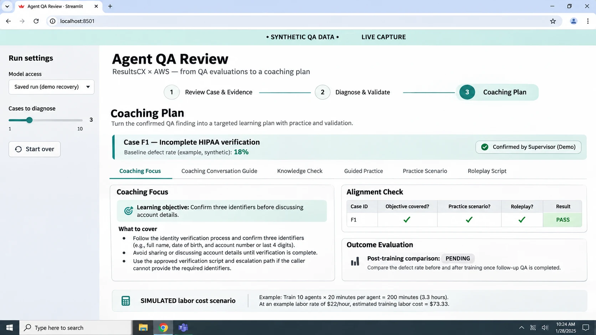

# Product experience and screenshot notes

These two images show the broader coaching experience our competition concept was aiming for: turning a QA finding into focused coaching, a knowledge check, guided practice, and realistic roleplay. They are **illustrative mockups**, not captures from the current `app.py` code. The internal `LIVE CAPTURE` text is decorative mockup text and should not be interpreted as a recording of a working session. The working Streamlit implementation uses four stages and renders a scripted roleplay, not a live interactive conversation.

## Roleplay concept

This concept image shows a fictional Case F2 documentation problem, roleplay branches, a knowledge check, guided practice, and an assumed labor-cost scenario. It communicates the proposed business value of reducing manual coaching preparation, but it does not measure actual supervisor time or calculate verified savings. **Separately, the working Streamlit app now includes a real, editable scenario calculator**; the image itself is still a mockup. The image's baseline and labor amounts are synthetic. Its post-training evaluation is pending.

## Coaching and alignment concept

This concept image shows a fictional Case F1 verification problem, a learning objective, an alignment table, and a simulated training-time cost. It is an illustration of how a coaching plan and its assumed costs could be presented, not a financial result produced by the current application. The visible desktop date is not evidence of when the 2026 competition occurred.

## What the visuals prove and what they do not

The mockups are useful as product design references, but they are not runtime evidence. A future improvement is a genuine capture of the public Streamlit walkthrough with the exact code revision, capture date, and **SYNTHETIC** label. Neither image proves a live AWS invocation, real supervisory approval, HIPAA compliance, or measured savings. Their three-part concept navigation is not the current four-stage Streamlit interface.

